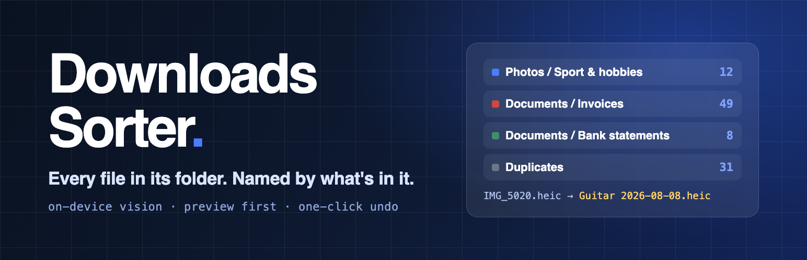
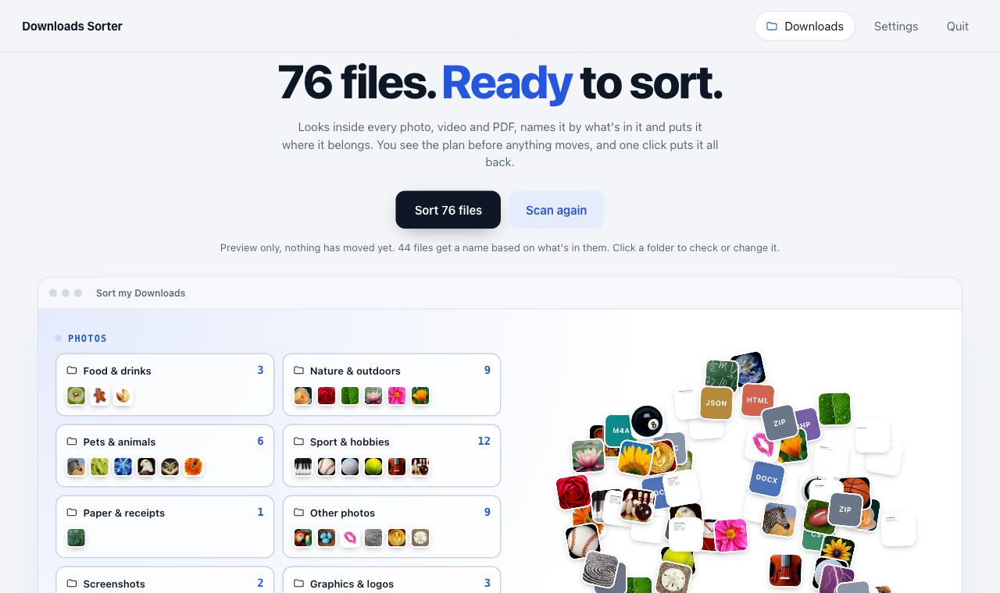
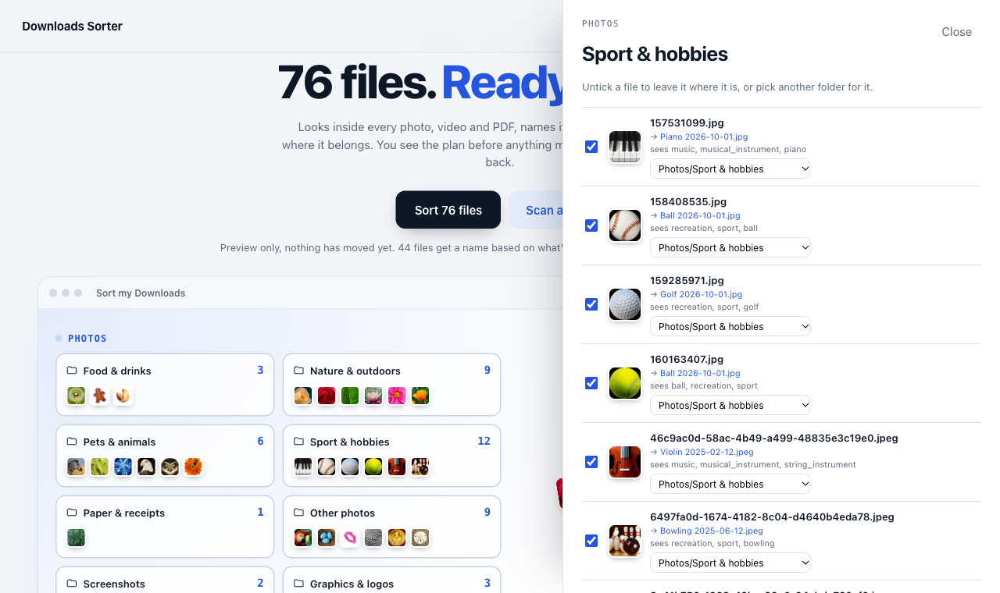
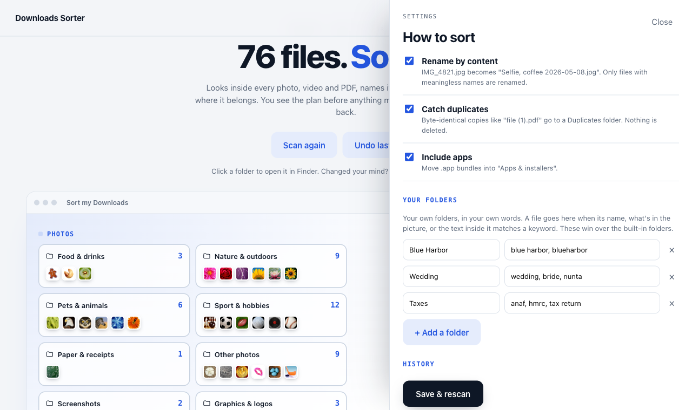
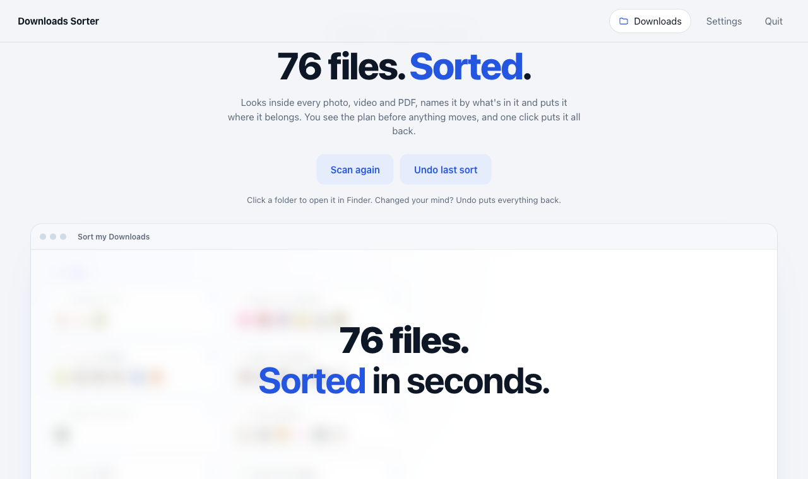

<p align="center">
  
</p>

<h1 align="center">Downloads Sorter</h1>

<p align="center">
  <strong>Every file in its folder. Named by what's in it. Undo in one click.</strong>
</p>

<p align="center">
  A free, local Mac app for anyone whose Downloads folder has quietly become a landfill.<br />
  It looks inside every photo, video and PDF with Apple's on-device Vision, renames <code>IMG_4821.heic</code> by what's in the frame,<br />
  and files everything into tidy folders. Review a manual preview, or opt into automatic sorting for new downloads. Undo reverses sorting.
</p>

<p align="center">
  
  
  
  
  
  
</p>

<p align="center">
  <a href="#-quick-start-under-2-minutes">Quick start</a> ·
  <a href="#troubleshooting-on-macos">Troubleshooting</a> ·
  <a href="#what-it-does">Features</a> ·
  <a href="#screenshots">Screenshots</a> ·
  <a href="#optional-organisation-features">Organisation options</a> ·
  <a href="#development">Development</a>
</p>

<p align="center">
  Author: <a href="https://www.nomad-developer.co.uk/">Costin Botez</a> (<a href="https://www.instagram.com/costinbotez/">@costinbotez</a>) ·
  <a href="https://www.nomad-developer.co.uk/">Portfolio</a> ·
  <a href="https://www.instagram.com/costinbotez/">Instagram</a> ·
  <a href="https://github.com/costibotez">GitHub</a>
</p>

---

## Why Downloads Sorter exists

Every Downloads folder ends up the same: 3,000 files called `IMG_4821.heic`, `10228315888.pdf`, `WhatsApp Image … at 6.51.15 PM (1).jpeg` and `invoice (3) (1).pdf`. Sorting by file type doesn't help, because a folder of 800 PDFs is still a mess. What you want is *invoices here, bank statements there, the wedding photos together*.

Downloads Sorter does that on your Mac, with no cloud and no API key:

- It **reads what's in the file**: what's in the picture, whether there's a face, how much text is on screen, the text inside a PDF.
- It **shows a plan first for manual sorts**: every folder with a count and thumbnails. Filter by size, untick files, or change destinations before moving anything. Optional watch mode sorts new downloads automatically.
- It **keeps you in control**. Sorting only moves files and can be undone. You can also review duplicates and empty files and explicitly move them to macOS Trash.

## What it does

### 🔍 Looks inside every file
- **Photos** are classified with Apple's on-device Vision (1,300+ scene labels, face detection, on-screen text) into People & selfies, Food & drinks, Nature & outdoors, Travel & city, Interiors & spaces, Pets & animals, Events & celebrations, Sport & hobbies and Paper & receipts
- **Screenshots** are recognised from macOS screenshot metadata, phone-screenshot shapes and text density. **Logos and graphics** are recognised by transparency and illustration labels
- **Videos** become *Talking head* (a face fills the frame), *B-roll* or *Screen recordings*. Three frames per clip are analysed
- **PDFs** are sorted by the text inside them, in English and Romanian: Invoices & receipts (*factură*, *invoice*), Bank statements (*extras de cont*, *opening balance*), Contracts & legal, Tax & accounting (*bilanț*, *ANAF*, *HMRC*), Travel & tickets, CVs and Scans
- **Audio** goes into Music, Sounds or Voice notes. **Everything else** is filed by type: Word & text, Spreadsheets & data, Presentations, eBooks, Emails & calendar, Archives, Apps & installers, Code & web, Fonts

### ✏️ Names files by what's in them
- Only meaningless names are renamed: camera rolls (`IMG_`, `DSC_`, `PXL_`), WhatsApp and Facebook exports, UUIDs, hashes and digit strings
- `IMG_5020.heic` → `Guitar 2026-08-08.heic`, `20230808_103547.jpg` → `Selfie 2023-08-08.jpg`. The date comes from the photo's EXIF data when it has one
- Files that already have a real name keep it. Name clashes get ` 2`, ` 3` instead of overwriting

### 🗂️ Your folders, in your own words
- Add a folder plus keywords in Settings, e.g. **Wedding**: `wedding, bride, nunta`
- A file goes there when its name, what Vision sees in it, the text on screen or the text inside the PDF matches a keyword
- Your folders take priority over the built-in ones

### 👀 Preview, then sort, then undo
- Every manual scan is a **preview**: folder cards with counts and thumbnails, plus a review drawer per folder to untick files or send them elsewhere
- **Filter by file size** limits the preview and sort to an inclusive MB/GB range; review rows show individual sizes
- **Sort** moves included files matching the current filter, with files flying from the pile into their folders
- **Undo** restores every file to its original place and name and removes the folders it created. History keeps your last 10 sorts

### 🧹 Catches the clutter
- **Duplicates**: byte-identical copies (`file (1).pdf`) are found by hash and moved to a *Duplicates* folder. The copy with the cleanest name stays in place
- **Empty files**: 0-byte failed downloads go to *Empty files*
- **Move to Trash**: after scanning, open the Duplicates or Empty files preview and click **Move to Trash** beside a file, then confirm. Files go to macOS Trash, never permanent deletion. Restore them in Finder’s Trash with **Put Back**; **Undo last sort** only reverses sorting. macOS may ask for permission to control Finder. If denied, allow it under **System Settings → Privacy & Security → Automation** for the launcher or Terminal, then retry.
- Skips partial downloads (`.crdownload`, `.part`, …), hidden files and anything modified in the last 2 minutes

### 🔒 Private by design
- **Nothing leaves your Mac.** Analysis runs in a small Swift helper using Apple's Vision, PDFKit and AVFoundation frameworks. There's no network call, account or API key
- The server listens on `127.0.0.1` only, and each launch requires a random token, so other web pages can't trigger a sort
- Cache, thumbnails, settings and undo history live in `~/Library/Application Support/Downloads Sorter/`

## ⚡ Quick start (under 2 minutes)

1. Clone the repo:
   ```bash
   git clone https://github.com/costibotez/downloads-cleanup.git && cd downloads-cleanup
   ```
2. Double-click **`Sort Downloads.command`**, or build a proper app with `./make-app.sh` and drag **Downloads Sorter.app** to your Dock.
3. When macOS asks whether it may access your Downloads folder, click **Allow**. If the project is on your Desktop or in Documents, allow access to that folder too.
4. Press **Look at my files**, optionally filter by size, check the preview, then press **Sort**.
5. For automatic sorting or year/month folders, open **Settings**. Both options start off; enable only the ones you want.

The first scan of ~3,000 files takes a minute or two. After that, results are cached and rescans are near-instant. Click the folder chip at the top to sort any other folder.

Keep the Terminal window open when using `Sort Downloads.command`; it runs the local server. If macOS blocks the launcher or the app closes immediately, see the troubleshooting steps below.

## Troubleshooting on macOS

### “Sort Downloads.command” Not Opened / Apple could not verify it

The launcher is not signed and notarised by Apple, so macOS may block it on first use. For a copy obtained from this repository that you trust:

1. Click **Done** in the warning, rather than **Move to Trash**.
2. Open **System Settings → Privacy & Security** and scroll to the **Security** section.
3. Find the message about `Sort Downloads.command` (or `Downloads Sorter.app`) and click **Open Anyway**.
4. Authenticate if asked, then confirm **Open**.
5. Allow folder access when prompted. The command launcher should open Terminal and then the browser; keep Terminal open while using the app.

If the message is missing, try opening the launcher again, then return to Privacy & Security. This creates an exception for that launcher; you do not need to disable Gatekeeper globally. See [Apple’s instructions for opening an unverified app](https://support.apple.com/en-gb/102445).

### The app closes immediately / “Operation not permitted”

If the log says Python cannot open `…/downloads-cleanup/app/server.py` with `Operation not permitted`, macOS is blocking access to the project folder. This can happen when the project is stored on the Desktop or in Documents.

1. Open the project folder in Finder and double-click **`Sort Downloads.command`**. If it is blocked as unverified, follow the steps above first.
2. Allow Terminal to access the folder containing the project when prompted.
3. If access was previously denied, open **System Settings → Privacy & Security → Files & Folders**, expand **Terminal** (or the app named in the permission prompt), and enable **Desktop Folder** or **Documents Folder**, as applicable.
4. Enable **Downloads Folder** access when prompted so the sorter can read and organise your downloads.
5. Close the failed launcher window and launch `Sort Downloads.command` again.

If Terminal is not listed yet, launch the command to trigger the access request, then check Settings again. See [Apple’s folder access instructions](https://support.apple.com/en-gb/guide/mac-help/mchld5a35146/mac).

The generated `.app` currently points to the original project folder; it is not a standalone bundle. Moving only `Downloads Sorter.app` to Applications does not remove its dependency on the Desktop copy. If you move the project, run `./make-app.sh` from its new location to rebuild the launcher.

For a failed `.app` launch, inspect the log in Terminal:

```bash
tail -n 30 "$HOME/Library/Logs/Downloads Sorter.log"
```

When using `Sort Downloads.command`, errors appear directly in its Terminal window.

### Warning that support for Intel-based apps is ending

On an Apple silicon Mac, this warning means an app or component is using Rosetta to run Intel code. It does not by itself explain an immediate launch failure: check the log for errors such as the folder access issue above.

Apple states that general Rosetta support remains available through macOS 27 and ends with macOS 28. Use an **Apple silicon** or **Universal** Python installation on an Apple silicon Mac, and rebuild the app with `./make-app.sh` on that Mac. The launcher uses the `python3` it finds on its configured PATH, so rebuilding alone does not replace an Intel Python installation. See [Apple’s Intel app compatibility guidance](https://support.apple.com/en-am/102527).

## Optional organisation features

After scanning, use **Filter by file size** above the preview to set a minimum, maximum, or both, in MB or GB. Bounds are inclusive and blank fields mean no limit. For example, minimum `100` MB shows files of at least 100 MB. Folder counts, review rows and **Sort** all follow the range; files outside it remain untouched. **Clear** restores the full preview without losing checkbox choices. Each review row shows its file size. MB and GB use decimal units, as in Finder. App bundle sizes are currently unknown, so bundles are excluded when a size bound is active. This filter applies only to manual previews, not watch mode.

Open **Settings** to configure these features:

- **Watch for new downloads** (off by default): while the app’s server runs, checks every 10 seconds and automatically sorts new files after at least 2 minutes without changes. Files already present when watching starts are left alone. Manual previews pause watching; completing the sort resumes it. Automatic sorts appear in History, labelled **automatic**. Undo and choosing a different folder turn watching off. Errors stop watching and appear in the UI. Watch mode never moves anything to Trash.
- **Year/month subfolders** (off by default): adds `YYYY/MM` beneath each category, for example `Photos/Nature & outdoors/2023/05`. Uses photo capture dates, labelled PDF document dates, then file creation date (modification date if unavailable). Duplicates and empty files keep their flat folders. Open a preview folder to see each full destination. Undo removes empty date folders it leaves behind.
- **Smarter PDF names** (part of **Rename by content**): numeric or generic names can become `Invoice – Engie – 2023-05-23.pdf`. Uses text from the first two PDF pages, a recognised document type, an explicit supplier/issuer field when present, and a labelled date in year-month-day or day-month-year numeric format. Meaningful filenames remain unchanged. Unrecognised PDFs retain their names; missing document dates fall back to file dates. Image-only scanned PDFs do not yet receive text-based names.

Watch mode runs only while Downloads Sorter is running; it does not install a login service. Keep Terminal open if using the command launcher. Enabling watch mode keeps the server running beyond its normal two-hour idle timeout. After restarting the app, watching establishes a fresh baseline, so downloads that arrived while it was stopped require a manual scan. Duplicate detection in each automatic batch compares that batch’s files, not files previously filed into subfolders.

The original three roadmap items are implemented. See [the implementation plan](docs/implementation-plan.md) for scope and validation.

## Screenshots

| Preview | Review a folder |
|---|---|
|  |  |

| Your folders & settings | Sorted |
|---|---|
|  |  |

<sub>Screenshots use a demo folder made from macOS stock pictures and generated documents (`docs/src/demo-files.sh`), so no personal files are shown.</sub>

## Development

- macOS with Python 3.9+ (standard library only) and the Xcode Command Line Tools for `swiftc`. No pip installs, no Node, no build step for the UI.
- The Swift helper is compiled on first launch, and again whenever `native/SorterVision.swift` changes. It reads `key<TAB>path` lines on stdin and writes one JSON object per file, using all but two CPU cores.
- Results are cached per file (path + size + modification time), so a rescan only analyses new files.

```
Sort Downloads.command   Double-click launcher (opens Terminal + browser)
make-app.sh              Builds "Downloads Sorter.app" with its icon
native/
  SorterVision.swift     On-device analysis: Vision labels, faces, OCR, PDF text, video frames, thumbnails
app/
  watcher.py             New-arrival tracking and stability checks
  server.py              Local web server: scan → plan → move → undo, token-protected API
  sorter.py              Rules: which folder each file goes to and what it's called
  static/                Interface (vanilla HTML/CSS/JS)
docs/
  banner.png, icon.png, screenshot-*.png
  src/                   Banner HTML, demo-folder generator and render script for the images above
```

Useful knobs:

| Where | What | Purpose |
|---|---|---|
| `sorter.py` → `CATEGORIES` | list | Folder names, order and grouping |
| `sorter.py` → `PHOTO_LABELS` | dict | Which Vision labels send a photo to which folder |
| `sorter.py` → `PDF_RULES` | list | Keywords that classify a PDF (first-match by most hits) |
| `sorter.py` → `GENERIC_LABELS` | set | Labels too vague to use in a file name |
| `server.py` → `RECENT_SECONDS` | int | Files newer than this are treated as still downloading (default 120) |
| `DOWNLOADS_SORTER_DATA` | env var | Use a different data directory (handy for testing on a copy) |

Run the regression checks (Node.js is needed only for the JavaScript checks, not to run the app):

```bash
python3 -m unittest discover -s tests -v
node tests/test_size_filter.js
node --check app/static/app.js
node --check app/static/size-filter.js
```

The tests use temporary files and mock Finder’s Trash operation; they do not move personal downloads. For manual validation, check the size controls, Finder permission prompt and Trash recovery, plus an incoming file with watch mode enabled. After pulling an update, quit and restart the app so the server loads the new code.

QA shortcut: test on a fake folder without touching your real Downloads:

```bash
bash docs/src/demo-files.sh /tmp/demo/Downloads
mkdir -p /tmp/demo/data && echo '{"folder": "/tmp/demo/Downloads"}' > /tmp/demo/data/config.json
DOWNLOADS_SORTER_DATA=/tmp/demo/data python3 app/server.py
```

To refresh the README images, run `./make-app.sh`, then `bash docs/src/render.sh` for the banner and icon. Retake the screenshots from the app at 1280×760.

## License

MIT.

---

<p align="center">
  
</p>

<p align="center">
  Built and maintained by <a href="https://www.nomad-developer.co.uk/">Costin Botez</a> — <a href="https://www.nomad-developer.co.uk/">Nomad Developer</a> · <a href="https://www.instagram.com/costinbotez/">@costinbotez</a><br />
  WordPress development, care plans and performance work for agencies and small businesses.
</p>
